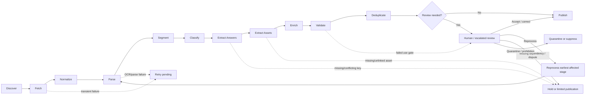

# Bestehen / Corpus — Stage 08: Ingestion and Extraction Pipeline

> **Status:** Authoritative Stage 08 product-shaping decision  
> **Product:** Bestehen / Corpus  
> **Initial domain:** German A2–B1 exam and exam-style material  
> **Primary downstream customer:** Bestehen / App  
> **Core principle:** Preserve raw evidence and uncertainty, progressively derive structured exam intelligence, and publish only the parts whose provenance, extraction quality, trust, rights, validation, and independence support their intended downstream use.

## 1. Purpose and Scope

This stage defines the end-to-end **product workflow** that turns discovered or manually supplied material into validated, traceable, structured Corpus data. It covers the lifecycle from discovery through fetch, normalization, parsing, segmentation, classification, answer and asset extraction, semantic enrichment, validation, duplicate handling, selective review, and publication.

The pipeline must work for clean official HTML and PDFs, imperfect unofficial documents, scans and photographs, DOC/DOCX, audio/video, detached answer keys, archives, incomplete exams, and mixed-media bundles. It must preserve the earlier product decisions that:

- successful fetching, OCR, transcription, parsing, or model output does **not** imply authenticity, confidence, legal reuse permission, correctness, or independence;
- incomplete material may remain useful without being made artificially complete;
- source incompleteness, extraction incompleteness, and linking incompleteness are separate states;
- source expression and non-reconstructive derived metadata have different rights implications;
- confidence, rights, extraction quality, taxonomy-assignment confidence, difficulty/relevance uncertainty, and duplicate independence are separate concerns;
- human corrections and governed taxonomy decisions must survive reprocessing;
- stable intelligence should be produced offline/incrementally and reused by Bestehen / App rather than regenerated per learner session;
- expensive AI or human review is reserved for uncertainty that materially affects product quality.

This is product shaping, not architecture. It does not choose queues, databases, workflow engines, OCR/ASR vendors, model providers, storage technology, parser libraries, embedding models, schedulers, or deployment topology. Later architecture may combine or parallelize conceptual states, but it must preserve their product semantics, gates, traceability, and failure behavior.

### 1.1 Stage objective

**Every source should have a predictable, auditable path from discovered evidence to published structured data, with partial success allowed, uncertainty localized to the smallest useful scope, bounded retry/review behavior, and a cheap default path that escalates only when higher-cost processing is justified.**

### 1.2 What a pipeline state means

The states below are **conceptual transformation states**, not a requirement for one physical job or database status per state. One implementation may combine several deterministic operations; another may process assets in parallel. The product must still be able to answer:

- what has happened to this source/document/component;
- what outputs were produced and from which source region/asset;
- which outputs failed or remain unresolved;
- which method/version produced each derived field or relationship;
- which review, retry, or reprocessing action is pending;
- whether an output is eligible for a particular downstream use;
- whether a later processing run superseded an earlier result.

A source can therefore be globally “partially processed” while individual Documents, Tasks, Items, Answers, Assets, transcripts, or taxonomy assignments have more precise local states.

---

## 2. Inputs / Existing Decisions

Stage 08 preserves the shared Product Overview, Identity, the live Corpus and App checklists, and Corpus Stages 01–07.

### 2.1 Stage 01 — mission and product boundary

`corpus/01-product-mission-and-boundaries.md` requires Corpus to turn broad A2/B1 material into trustworthy, rights-aware, deduplicated intelligence for Bestehen / App. Stable exam intelligence should be precomputed, batched, cached, reviewable, and reprocessable rather than generated per learner interaction.

### 2.2 Stage 02 — source strategy

`corpus/02-source-strategy.md` established automated discovery plus manual URL/file intake; HTML, PDF, DOC/DOCX, scans/images, audio, video, and ZIP/archive support; permanent provenance; source version history; bounded revisits; mirror/alternate handling; and distinct **candidate → source observation → underlying material** concepts.

Stage 08 must never collapse multiple observations into false independent evidence.

### 2.3 Stage 03 — confidence and trust

`corpus/03-trust-authenticity-confidence.md` requires confidence at source, document, exam, task, and item levels, with local defects overriding parent assumptions. Tier A/B/C/D and Quarantine control downstream influence. Conflicting keys are first-class disputes. Parsing success never upgrades evidence confidence automatically.

### 2.4 Stage 04 — rights and usage

`corpus/04-rights-and-usage-metadata.md` requires rights evidence early enough to block unsafe downstream publication, while reference-only material can still contribute non-reconstructive intelligence. `UNKNOWN_REVIEW_REQUIRED` is the conservative default when rights are unclear. Takedown holds pause normal reprocessing and source-derived use.

### 2.5 Stage 05 — canonical exam model

`corpus/05-canonical-exam-model.md` defines Source Observation → Document → Exam/Test Set → Section → optional Part → Task → Item, with Instructions, Stimuli, Response Options, Answers, Explanations, Scoring Rules, and Assets as separately addressable supporting concepts.

Stage 05 also requires a hard distinction among:

- **source incompleteness** — the acquired material itself lacks expected content;
- **extraction incompleteness** — the source contains material Corpus failed or has not yet extracted;
- **linking incompleteness** — components exist but their relationship is not yet verified.

Stage 08 preserves that distinction throughout the lifecycle.

### 2.6 Stage 06 — taxonomy

`corpus/06-exam-and-skill-taxonomy.md` requires deterministic structural tags first, semantic enrichment later, assignment-level origin/confidence/version, and curator-safe reprocessing. Fine-grained AI mappings are provisional before benchmark qualification; high-impact taxonomy auto-publication uses the Stage 06 starting target of about **95% measured precision or better** for the relevant benchmark slice, with no known systematic learner-diagnosis failure.

### 2.7 Stage 07 — difficulty and relevance

`corpus/07-difficulty-and-relevance-models.md` requires versioned method/origin metadata for L/R/T/A/P difficulty and GB1/TELC relevance, explicit estimate confidence, unknown/N/A handling, and offline/batched recalculation. A missing transcript, timing rule, answer, rubric, or taxonomy mapping can leave only part of a difficulty profile publishable.

No earlier decision is replaced by Stage 08.

---

## 3. Decisions and Rationale

### 3.1 Canonical conceptual lifecycle

**Decision:** Bestehen / Corpus uses this conceptual lifecycle:

**Discover → Fetch → Normalize → Parse → Segment → Classify → Extract Answers → Extract Assets → Enrich → Validate → Deduplicate → Review → Publish**

The order communicates responsibility and gating rather than requiring strictly serial execution. A parser may discover an image while parsing a PDF, and assets may be processed alongside answers. The outputs remain conceptually separate so one failure does not hide success elsewhere.

### 3.2 State diagram

The arrow from reprocessing to Parse is illustrative. Reprocessing starts from the **earliest affected dependency**: source changes may require Fetch; a new OCR method may start at Parse; a taxonomy update may start at Classify/Enrich.

### 3.3 Publication is a promotion decision, not a perfection claim

`Publish` means an entity/field passed the gates required for its documented downstream uses. It does **not** mean that the source is official, reusable, complete, Tier A/B, learner-facing, fully independent, or fully enriched.

Corpus supports partial publication. An answerless reading task may publish task structure, topic, language, and skill evidence while remaining ineligible for correctness-dependent analysis. A listening task with no source audio may publish its text structure while audio difficulty remains unknown.

### 3.4 Human review is exception-based

The review state is mandatory conceptually, but a human action is not. Records that satisfy benchmarked auto-accept rules pass through the review gate automatically. Human effort is reserved for ambiguity or conflict whose resolution changes a meaningful product outcome.

### 3.5 Processing cost is tiered by evidence value

Corpus does not use the best/most expensive model by default. Every record begins with deterministic/local processing where useful, advances to cheap/batched semantic processing only when needed, and reaches stronger models or humans only when the expected downstream value justifies the incremental cost.

---

## 4. Detailed Product Model / Rules for This Stage

## 4.1 The thirteen pipeline states

| State | Product responsibility | Normal output | What success does **not** imply |
|---|---|---|---|
| **Discover** | Identify a candidate worth considering | candidate, discovery route, location/origin clues, first-seen context | trust, rights, relevance certainty |
| **Fetch** | Obtain a recognizable payload through permitted access | bytes/content, transport metadata, redirects, observation/version evidence | safety, authenticity, completeness |
| **Normalize** | Prepare stable non-destructive processing representations | archive members, page/media references, text-vs-scan detection, normalized encoding | correct interpretation |
| **Parse** | Recover machine-readable content/layout | native text, OCR, headings, tables/forms, embedded references, source markers | canonical exam structure |
| **Segment** | Map content to Stage 05 entities/relationships | exam/section/task/item/instruction/stimulus/options plus unresolved components | every boundary is certain |
| **Classify** | Apply cheap/structural Stage 06 normalization | provider claim, CEFR, Section, task/response/stimulus/interaction facets | authenticity or fine semantic skill truth |
| **Extract Answers** | Represent source/reference answer and scoring assertions | answer assertions, key relationships, rubric/scoring evidence, detached candidates | correctness when evidence conflicts |
| **Extract Assets** | Inventory and link media/components | Asset records, candidate mappings, integrity/rights/provenance state | exact task/item alignment |
| **Enrich** | Produce higher-level semantic intelligence | topic, grammar, vocabulary, skills, reasoning, distractors, difficulty/relevance, confidence/rights candidates | source truth or legal conclusion |
| **Validate** | Apply integrity and use-specific gates | pass/partial/fail reasons and review/reprocess routing | Stage 10 production QA is complete |
| **Deduplicate** | Establish/conservatively bound evidence independence | duplicate/derivative/independence status or unresolved flag | Stage 09 algorithm details are decided here |
| **Review** | Resolve or preserve high-impact ambiguity | accept, restrict, correct, dispute, reprocess, quarantine, reject, legal/takedown state | every uncertainty must be resolved |
| **Publish** | Promote current eligible structured outputs | active version + restrictions + lineage + confidence/version metadata | direct learner reuse or universal fitness |

### 4.1.1 Discover

Discovery preserves how the lead was found: official seed, targeted search, link traversal, repository/archive lookup, manual URL, or manual file. Irrelevant candidates exit active intake. Gated candidates may remain known leads; the pipeline does not require access circumvention.

### 4.1.2 Fetch

Fetch records enough information to distinguish a real payload from an error/login/placeholder page and preserve redirects/resolved locations. Transient network/server/rate-limit failures enter bounded retry. Persistent dead sources follow Stage 02 revisit rules rather than retrying indefinitely.

### 4.1.3 Normalize

Normalization is non-destructive. Archive containers can be decomposed into individually traceable members; PDFs into stable page references; video into addressable audio/visual components where useful. The original/versioned source remains the evidence anchor subject to Stage 04/15 retention.

### 4.1.4 Parse

Parsing may recover native text, OCR/layout, table/form structure, headings/numbering, embedded links/assets, candidate source terms, and answer-key markers. Parsed text/structure is **derived evidence** with page/region lineage; it never replaces the raw page/file as source truth.

### 4.1.5 Segment

Segmentation identifies the Stage 05 hierarchy and shared supporting entities by semantic function, not visual layout alone. Ambiguous Part/Task/Item boundaries remain provisional. One intact Task may proceed when another region cannot be segmented.

### 4.1.6 Classify

The first classification pass favors explicit/deterministic normalization: provider/exam-family claim, declared CEFR, normalized Section, task activity family, response mechanic/cardinality, stimulus form, interaction shape, completeness/source role. Fine semantic tagging is primarily Enrich.

### 4.1.7 Extract Answers

Every correctness/scoring claim remains attributable to evidence. Source answers, curator-resolved answers, source-provided sample responses, and machine-inferred candidate answers have different origins. Missing expected keys remain missing. Competing plausible keys become `disputed` locally.

### 4.1.8 Extract Assets

Assets include audio/video, images/scans, diagrams/maps/charts, tables/forms, visual prompt cards, answer-sheet templates, and retained page crops. Orphan/unlinked assets are valid intermediate records. Similar filenames are candidate evidence, not sufficient proof of a relationship.

### 4.1.9 Enrich

Enrichment can produce topic, grammar, vocabulary/domain, Reading/Listening skills, Writing/Speaking competency affordances, reasoning/distractor patterns, lexical relations, confidence evidence, rights-term candidates, Stage 07 difficulty, and GB1/TELC relevance. Every derived output is method/version/confidence aware.

### 4.1.10 Validate

Stage 08 validation is the pipeline gate, not the full Stage 10 QA program. It must detect/route impossible structural relationships, cardinality contradictions, invalid answer references, missing required dependencies, critical extraction defects, contradictory provider/level/section claims, completeness mismatches, blocked rights/trust states, and enrichment whose precision exceeds its input quality.

Validation is **use-specific**. A record can pass topic analysis while failing correctness-dependent analysis.

### 4.1.11 Deduplicate

Stage 09 owns fingerprinting, similarity thresholds, derivative rules, canonical-record selection, and independent-evidence counting. Stage 08 requires only that decision-grade publication never assume independence merely because two sources have different URLs. Unresolved independence receives conservative influence.

### 4.1.12 Review

Review outcomes include accepted; accepted with restrictions; corrected; limited/provisional; disputed; reprocess; awaiting dependency/corroboration; quarantined; rejected as evidence; rights/legal review required; and takedown/prohibited.

### 4.1.13 Publish

Published data retains lineage, current authenticity/confidence, rights status, extraction/assignment/estimate confidence, derivation method/version, human override state, completeness, unresolved dependencies, duplicate/independence treatment, and current/superseded status.

Publication classes are:

1. **normal eligible use** — the output passes its documented production gates;
2. **limited/provisional** — the output is visible only for bounded uses such as exploratory analytics or broad context;
3. **not active/held** — retry, dependency block, dispute, quarantine, prohibition, or unresolved review excludes the affected use.

---

## 4.2 Partial-failure, retry, and hold behavior

**Decision:** Corpus follows **salvage-first, isolate-the-failure** behavior. A defect blocks the smallest scope whose correctness depends on it unless evidence shows a larger unit is unreliable.

| Failure type | Meaning | Default behavior |
|---|---|---|
| Fetch failure | payload unavailable | bounded retry or later revisit; no extraction from this observation |
| Container/member failure | one archive member/page/media component cannot be normalized | isolate component; continue unaffected members if safe |
| Extraction failure | source content exists but parsing/OCR/ASR did not recover it reliably | mark extraction incomplete; alternate method/review; never label source content “missing” because extraction failed |
| Segmentation failure | content exists but canonical boundary is uncertain | keep broader structure/unresolved component; block only fine-grained uses |
| Linking failure | components exist but relationship is uncertain | preserve detached key/audio/transcript; never force link by filename/position alone |
| Classification/enrichment failure | semantic metadata cannot be assigned responsibly | keep unknown/provisional; publish stronger structural data if eligible |
| Validation failure | output contradicts integrity/use rules | block affected output; reprocess/review |
| Dedup uncertainty | independence unresolved | conservative evidence mass; no mirror inflation |
| Trust/rights hold | structurally useful but restricted evidence | preserve allowed non-reconstructive intelligence; block prohibited uses |
| Quarantine | serious fake/tamper/integrity/security concern | zero normal downstream influence until resolution |

### Retry and intervention states

Corpus must support conceptually:

- `retry_pending` — recoverable/transient failure within a bounded retry budget;
- `reprocess_candidate` — upstream dependency or processing method changed;
- `blocked_dependency` — a companion component/link is missing or unresolved;
- `review_required` — human/escalated review is worth the cost;
- `disputed` — strong evidence conflicts on a material claim;
- `quarantined` — zero normal influence pending resolution;
- `rejected_as_evidence` — retained only as policy allows, with no normal influence;
- `prohibited/takedown_hold` — Stage 04/15 state blocks normal processing/use;
- `superseded` — a newer successful processing result replaces the active derived version without erasing history.

### Retry principles

1. **No infinite retries.** Repeated unchanged-input/unchanged-method failure leaves automatic retry and becomes deferred/reviewable.
2. **Retry only the affected dependency.** Failed ASR should not refetch a stable booklet.
3. **Differentiate transient from deterministic failure.** A temporary HTTP error is retryable; a parser that repeatedly cannot interpret a layout needs another method or review.
4. **Impact determines escalation.** A unique TELC listening asset may justify stronger processing; a redundant D-tier duplicate usually does not.
5. **Preserve failure reason and method version** so improved methods can target the right records later.

Exact numerical retry limits and schedules belong to Stage 14/architecture.

---

## 4.3 Human-review checkpoints

**Decision:** Human review can be triggered at five logical checkpoints. It is not a mandatory stop at each checkpoint.

| Checkpoint | What can trigger review | Auto path when no trigger exists |
|---|---|---|
| **A — Intake/trust/rights exception** | suspected fake/tamper, serious acquisition issue, ambiguous high-value official claim, rights/legal ambiguity affecting intended use | continue processing with conservative trust/rights state |
| **B — Structure/extraction** | ambiguous Exam/Part/Task/Item boundary; unreadable critical page; layout-dependent table/form not recovered; high-value TELC structure anomaly | accept benchmark-qualified deterministic/parser output or keep broader structure |
| **C — Answer/asset linkage** | conflicting key, uncertain edition mapping, scoring-rule ambiguity, critical missing audio/image, uncertain audio↔task/item mapping | auto-link explicit/validated relationships; keep detached components otherwise |
| **D — Semantic enrichment** | ambiguous primary skill/reasoning/distractor mapping, anomalous difficulty/relevance, generated metadata conflicting with curated rules, high-value unique evidence | accept only benchmark-qualified fields; otherwise publish broad/provisional metadata |
| **E — Pre-publish integrity** | validation failure, unresolved independence that would distort analytics, proposed direct-use content with incomplete gates, new method contradicting a human correction | publish only eligible fields or hold/review affected scope |

### Review prioritization

Human review is ordered by expected product impact rather than simple FIFO:

1. wrong-answer/scoring risk or direct learner exposure;
2. TELC target-format/priority decisions;
3. benchmark/gold-standard records;
4. unique evidence filling a major provider/section/format gap;
5. high-value ambiguity likely to become reusable after one correction;
6. low-impact duplicated/noisy material last.

A growing review backlog does **not** require blanket resolution. Low-impact records can remain provisional/limited indefinitely.

### Manual-decision behavior

A human correction or override must retain author/time/rationale/evidence and takes precedence over later automated reruns unless the underlying source or governed product rule materially changes. Reprocessing may propose a conflicting candidate result; it may not silently overwrite a reviewed correction.

---

## 4.4 Auto-accept versus review rules

**Decision:** Auto-accept depends on **field criticality + method benchmark performance + input quality + deterministic validation**, not a model’s self-reported confidence.

### 4.4.1 Auto-accept classes

| Output class | Starting auto-accept rule | Otherwise |
|---|---|---|
| **Explicit/deterministic structural facts** | source explicitly supplies the fact or deterministic mapping is unambiguous, and structural validation passes | unknown/provisional/review if material |
| **Low-risk broad semantic metadata** | benchmark-qualified method for that slice; errors would not materially misdiagnose learners or establish correctness | provisional/broader tag; review only if valuable |
| **High-impact taxonomy mappings** | preserve Stage 06 default: about **95% measured precision or better** on the relevant benchmark slice, with no known systematic harmful failure | provisional or broader parent tag; selective review |
| **Correctness-critical answer/key/scoring links** | explicit exact source relationship plus deterministic checks, **or** a benchmarked method initially targeting roughly **99% precision** on the applicable slice with an independent validation signal | review/disputed/unlinked; never invent source truth |
| **Critical audio↔item segment alignment** | explicit source segmentation or benchmarked alignment whose error would not change answer interpretation; high-risk answer-bearing segments need independent validation | use coarser task/track alignment or review |
| **Authenticity/officiality** | verified provenance rules from Stage 03, not semantic resemblance/model confidence | claimed/unverified, uncertain, or review |
| **Rights interpretation** | deterministic mapping of clear, scoped standard permission/license evidence may be operationalized; ambiguous/custom/legal interpretation is never AI-auto-approved | `UNKNOWN_REVIEW_REQUIRED` / legal review |

The **99% correctness-critical precision target** is an initial conservative product threshold, not a calibrated permanent constant. Stage 10/16 should replace it with benchmark evidence and may use field-specific targets. The Stage 06 ~95% high-impact taxonomy target remains unchanged.

### 4.4.2 Hard auto-accept prohibitions

Automation must not silently:

- convert an AI-inferred answer into a source-provided correct answer;
- resolve competing plausible answer keys by majority mirror count;
- upgrade an unverified “real TELC” claim to Verified official from visual similarity;
- turn an ambiguous rights statement into reusable permission;
- overwrite a curator correction or governed taxonomy decision;
- publish a precise difficulty/relevance score when required inputs are missing/low-quality;
- treat unresolved duplicates as independent evidence;
- publish quarantined/prohibited material into normal analytics/direct use.

### 4.4.3 Confidence gates remain independent

High extraction accuracy does not upgrade Stage 03 evidence confidence. A perfectly parsed low-confidence mock remains low-confidence evidence. Conversely, a Tier A official scan with poor OCR can remain highly authentic while its extracted text is too unreliable for exact-content use.

---

## 4.5 Scanned documents and OCR

**Decision:** Scans/images are first-class supported inputs. OCR is a derived representation with local extraction confidence, not a replacement for the visual source.

### 4.5.1 Scan handling sequence

1. **Detect per page/region** whether usable native text exists, the page is image-based, or it is mixed.
2. Prefer native text for native regions; do not OCR clean text merely because OCR is available.
3. For scanned regions, use the lowest-cost method that preserves needed semantics: local/deterministic OCR first where benchmark quality is adequate.
4. Preserve page/region mapping from OCR text back to the source image.
5. Preserve layout when layout affects meaning, especially tables, forms, matching columns, notices, advertisements, answer sheets, and multi-column keys.
6. Escalate only affected pages/regions to stronger OCR/layout analysis when the value justifies it.
7. If critical text remains unreliable, keep it extraction-incomplete or send it to review rather than guessing.

### 4.5.2 OCR quality consequences

- Low-confidence text in a decorative/non-tested area may not block the Task.
- Low-confidence item numbering, answer choices, negation, dates/numbers, response cardinality, scoring values, or key entries can block correctness-dependent use.
- If a table is flattened so relationships are lost, the task is not considered faithfully parsed merely because all words were recovered.
- OCR failure means **extraction incomplete**, not **source incomplete**.
- A clearer mirror may be used as the extraction asset while the original remains the provenance anchor, preserving Stage 02.

### 4.5.3 OCR cost rule

Do not run premium OCR over every page by default. Process clean native pages deterministically; OCR only pages requiring it; escalate only low-quality regions that affect high-value structure, answers, rights, or TELC intelligence.

---

## 4.6 Audio/video transcription and alignment

**Decision:** Audio/video Assets remain the source evidence. Transcripts and alignments are separately versioned derived components unless a source-provided transcript exists.

### 4.6.1 Transcript origins

Corpus distinguishes:

- **source-provided transcript** — source content with its own provenance/rights/confidence;
- **human-curated transcript/correction** — reviewed derived representation;
- **ASR-derived transcript** — machine-generated metadata/content with ASR model/version and confidence;
- **partial transcript** — only selected segments transcribed;
- **no transcript** — valid when semantic transcription is unnecessary or cannot be produced responsibly.

An ASR transcript must never be mislabeled as provider-authored/source text.

### 4.6.2 When transcription is required

Full transcription is **not mandatory for every audio asset**. It is required when the downstream job needs semantic spoken content and cannot use a source transcript or cheaper representation, for example:

- linking spoken content to answer evidence;
- semantic Listening skill/reasoning/distractor analysis;
- transcript-based linguistic difficulty/features;
- validating numbers, dates, conditions, corrections, or key claims;
- producing a benchmark/gold record.

Acoustic features such as duration, speech rate estimates, speaker changes, or noise can sometimes be derived without a complete transcript.

### 4.6.3 Alignment precision levels

Use the **coarsest defensible alignment**:

1. Asset ↔ Section/Task;
2. Asset segment ↔ Task/Stimulus;
3. Asset segment ↔ Item;
4. word/utterance-level alignment only when a downstream need justifies it.

If exact timestamps are uncertain, keep whole-track/task mapping rather than inventing item-level precision. An alignment stores method/version/confidence and can later be refined.

### 4.6.4 Critical listening content

ASR uncertainty affecting answer-critical **numbers, dates, times, prices, negation, restrictions, speaker corrections, or names/entities** must lower confidence and may trigger stronger transcription/review. An apparently fluent transcript does not guarantee correctness on these high-impact tokens.

### 4.6.5 Missing audio

If a listening task has a transcript but the audio is missing, semantic text analysis may proceed where appropriate, but Stage 07 audio difficulty remains `unknown`. Reading a transcript is not equivalent to Listening evidence.

### 4.6.6 Video

Video may yield separately traceable audio, visual prompt, captions, and transcript derivatives. The pipeline does not assume the audio track alone captures all tested information if visual content matters.

### 4.6.7 Audio cost rule

Prefer source transcripts when reliable; avoid full ASR when only asset presence/duration is needed; batch/local ASR where adequate; reserve stronger models/manual correction for answer-critical, benchmark, or uniquely valuable TELC listening evidence.

---

## 4.7 Answer-key and scoring linking

**Decision:** Answer-key linking is a first-class evidence relationship, not positional glue.

### 4.7.1 Evidence used for linking

A strong link can use combinations of:

- explicit source relationship/container membership;
- exact exam title/edition/version;
- provider/exam-family identity;
- Section/Part/Task labels;
- item numbering and count;
- response-option/cardinality structure;
- source-provided cross-reference;
- matching document/asset version evidence;
- independent semantic validation where necessary.

Filename similarity alone is insufficient when a version mismatch could teach a wrong answer.

### 4.7.2 Link states

Answer/key/scoring relationships can be:

- **verified/accepted**;
- **candidate**;
- **review_required**;
- **disputed**;
- **detached/unlinked**;
- **superseded** after a corrected edition/erratum.

### 4.7.3 Auto-linking

Auto-link when the exact source/version relationship is explicit and deterministic checks agree, or when a benchmark-qualified linking method meets the correctness-critical gate in Section 4.4 and independent validation agrees.

Otherwise preserve the answer key as a detached/candidate component. Do not force association merely to make the exam complete.

### 4.7.4 Conflicting keys

When plausible keys conflict:

- preserve each assertion and provenance;
- mark the affected Item/Task `disputed` under Stage 03;
- block learner scoring truth, correctness-dependent difficulty calibration, distractor analysis, and answer-grounded generation for the affected claim;
- continue unaffected non-correctness analysis;
- resolve according to Stage 03 evidence precedence/review, not popularity.

### 4.7.5 Inferred answers

A model or human may create an **inferred candidate answer** for analysis/review. It remains explicitly inferred and cannot silently become a source Answer. Learner-facing correctness use still requires the confidence/review gates established in Stages 03 and 08.

---

## 4.8 Asset expectations beyond OCR/audio

Every asset should have enough state to represent:

- source/provenance and current availability;
- integrity/extraction status;
- semantic role where known;
- relationship to Document/Stimulus/Instruction/Task/Item;
- rights and local confidence overrides;
- derived representations such as OCR text, crops, thumbnails, transcripts, or extracted audio tracks;
- relationship confidence/alignment state.

A critical missing asset blocks only uses that require it. A writing task with a missing decorative image can remain usable; a speaking prompt whose picture card defines the task cannot be considered complete for direct simulation without that image or an explicitly original replacement in the App.

Derived asset representations inherit lineage but not automatically the same downstream permission: Stage 04 remains authoritative for whether an external model, exported transcript, or derivative is allowed.

---

## 4.9 Traceability for AI-generated and derived metadata

**Decision:** Every non-source field/relationship that can materially affect Corpus/App behavior must have a **derivation record** sufficient to explain and reproduce the decision class without storing private chain-of-thought or unnecessarily duplicating source expression.

### 4.9.1 Required derivation metadata

Conceptually capture:

- **origin type:** `source_explicit`, `deterministic_rule`, `model_generated`, `human_curated`, `human_corrected`, `imported/migrated`, or `empirically_calibrated`;
- **input identities/versions:** the Document/Task/Item/Asset/transcript/taxonomy inputs used;
- **pipeline stage/output field** produced;
- **method/rule/model identifier and version**;
- **prompt/template/schema version** when model prompting materially affects the result;
- **taxonomy version** for taxonomy assignments;
- **difficulty/relevance rubric version** for Stage 07 estimates;
- **processing run ID/time** or equivalent audit grouping;
- **output confidence/uncertainty and review state**;
- **validation result** used for auto-accept when applicable;
- **processing mode relevant to rights**, e.g. local, external raw-source processing, or abstraction-only processing where the distinction matters;
- **human override/correction and rationale** when present;
- **current/superseded relationship** to later derivations.

### 4.9.2 What is not required

The product does **not** require preserving private chain-of-thought, hidden reasoning, or every transient prompt token. It requires a stable method/template/schema version and the structured evidence needed to audit the output. Full raw model responses/prompts may be retained selectively for benchmark/debug purposes only when rights/security/retention rules allow and the value justifies storage.

### 4.9.3 Model confidence is not product confidence

A model’s self-reported confidence is merely an input. Production acceptance depends on benchmark performance, input quality, deterministic validation, Stage 03 confidence, and field-specific risk.

### 4.9.4 Human corrections are durable

A reviewed correction creates a higher-precedence derivation. Later automated reprocessing may propose an alternative but cannot silently overwrite it. If a materially changed source or governed taxonomy/rule invalidates the correction, the record becomes reviewable rather than auto-reverted.

---

## 4.10 Reprocessing when extraction methods/models improve

**Decision:** Reprocessing is **dependency-scoped, versioned, non-destructive, and promotion-gated**.

### 4.10.1 Reprocessing triggers

A record becomes a reprocessing candidate when one or more of these materially changes:

- source bytes/content/version;
- parser/layout method;
- OCR method;
- ASR/transcription/alignment method;
- segmentation/classification rules;
- taxonomy version or task mapping;
- semantic model/prompt/template/schema;
- confidence model evidence/dimensions;
- Stage 07 difficulty/relevance rubric/model;
- answer-key/scoring evidence or edition link;
- rights terms/status;
- duplicate/independence relationship;
- benchmark evidence showing the current method is systematically weak;
- a manual correction revealing a class of similar failures.

### 4.10.2 Start from the earliest affected stage

Examples:

- new source bytes → Fetch/Normalize onward;
- improved OCR for unchanged scan → Parse onward;
- better audio alignment → Extract Assets/Enrich/Validate onward;
- taxonomy minor/major change → Classify/Enrich onward for affected assignments;
- difficulty-rubric update → Enrich/Validate only;
- new answer key → Extract Answers onward;
- dedup correction → Deduplicate and dependent analytics, not OCR/ASR.

### 4.10.3 Do not silently overwrite history

Reprocessing produces a new candidate derivation/version. After validation/review:

- the new result may become current;
- the prior result becomes superseded but remains auditable as policy permits;
- downstream outputs that depended on changed fields become stale/recompute candidates;
- confidence can rise **or fall** after a better method or new evidence.

### 4.10.4 Protect curated decisions

Human-curated taxonomy semantics, manual corrections, resolved answer disputes, and rights/legal decisions are not erased by a model-version bump. Reprocessing carries them forward unless the underlying evidence/rule changes enough to require explicit review.

### 4.10.5 Reprocess selectively

Use stored method/version/failure metadata to target records likely to benefit. Do not rerun every model over every unchanged item simply because a new version exists. Reuse shared-stimulus/audio results and exact duplicate outputs where Stage 09/rights semantics permit.

### 4.10.6 Takedown/prohibited material

Normal reprocessing remains paused for material under an active takedown/prohibition unless the authorized review itself requires a narrowly scoped operation. A better model is not a reason to reopen prohibited source content.

---

## 4.11 Cost-conscious processing tiers

**Decision:** The pipeline uses four conceptual cost tiers. These are product priorities, not a mandate for specific vendors or infrastructure.

| Tier | Default work | Typical examples | Escalation rule |
|---|---|---|---|
| **Tier 0 — deterministic/local baseline** | near-zero/low recurring cost, reusable checks | fetch metadata, hashes/identity, archive/member handling, native text, explicit numbering, provider/CEFR labels, response cardinality, asset manifest, explicit key links, simple validation/features | always try first when applicable |
| **Tier 1 — cheap/local/batched extraction & enrichment** | low-cost models/open-source/local processing where benchmark quality is adequate | OCR only where needed, ASR when needed, layout recovery, broad topic/grammar/skill candidates, lightweight difficulty features, candidate links | use for material with clear downstream value; cache results |
| **Tier 2 — selective stronger model/analysis** | materially higher per-record cost | ambiguous segmentation, poor OCR/ASR, difficult primary-skill/reasoning/distractor mapping, productive rubric mapping, uncertain high-value answer/asset links, anomalous TELC relevance | invoke only when lower tier is insufficient **and** resolution can change a meaningful product outcome |
| **Tier 3 — human / legal / gold-standard review** | highest scarce cost | conflicting keys, suspected fake/tamper, ambiguous rights/legal use, benchmark records, unique TELC evidence, unresolved correctness-critical cases | reserve for highest-impact ambiguity |

### 4.11.1 Escalation score is qualitative, not a new formula

A case deserves higher-cost processing when several of these are true:

- it is direct/current TELC evidence;
- it is unique or fills a material coverage gap;
- an unresolved field controls answer correctness/scoring;
- it materially affects App learning priorities or generation grounding;
- it is proposed for direct learner use;
- it belongs to Stage 16 benchmark/gold data;
- a cheap method demonstrably fails on this format;
- one review could unlock many related records through a reusable rule/correction.

A low-confidence duplicate with strong alternative coverage should usually remain deferred rather than escalated.

### 4.11.2 Batch/cache/shared-content rules

- Semantic model calls are offline/batched, not per learner session.
- Unchanged source + unchanged method/version should not be reprocessed.
- Shared Stimuli, option banks, audio, and source-level rights/provenance context are processed once and reused.
- OCR/ASR can be page/segment selective rather than whole-document by default.
- Model prompts should receive only the minimum source expression needed for the task, consistent with Stage 04 rights and processing constraints.
- When external raw-source processing is not clearly allowed, use local processing or already-derived abstractions instead of sending the raw source to a third-party model.

### 4.11.3 Cheaper fallback

When premium processing is not justified, the preferred fallback is **unknown, broader, provisional, detached, or limited publication**—not fabricated precision.

---

## 4.12 Publication gates by use

The pipeline should not produce one universal “trusted” bit. Typical use gates are:

| Proposed use | Minimum pipeline posture |
|---|---|
| provenance/inventory search | source registered; even held/rejected records may remain visible internally according to policy |
| structural exploratory analytics | parsed/segmented enough for the question; extraction uncertainty visible |
| topic/broad taxonomy analytics | validated assignment; source confidence eligible for the analytical use |
| fine learner-model taxonomy attribution | benchmark-qualified mapping per Stage 06 + eligible Stage 03 confidence |
| correctness/distractor/scoring analysis | validated accepted answer/scoring relationship; no dispute |
| difficulty calibration | Stage 07 inputs complete enough + B+ source evidence; C cannot calibrate production difficulty |
| recurrence/relevance | duplicate/independence treatment applied; unresolved relationships conservative |
| direct learner source exposure | Stage 03 B+ local confidence + Stage 04 permission/conditions + validated exact extraction/assets/answers where relevant |
| original App generation from restricted evidence | publish non-reconstructive pattern abstractions; do not pass restricted source expression merely to paraphrase it |

---

## 5. Edge Cases / Failure or Uncertainty Handling

### 5.1 Official source page links booklet, key, and audio; audio fetch fails

Process/publish the booklet and key normally where eligible. Keep the audio Asset as expected/failed-fetch. Audio-dependent Listening semantics and Stage 07 `A` remain blocked/unknown until audio is recovered.

### 5.2 ZIP contains one corrupt file

Retain bundle provenance and process healthy members. The corrupt member receives a local failure state; the archive is not rejected automatically.

### 5.3 Scanned PDF produces no native text

Route scanned pages to OCR. Do not label the document empty or source-incomplete because a native-text parser returned nothing.

### 5.4 OCR gets item numbers but not choices reliably

The Task/Item skeleton may publish for structure. Choice/answer text remains extraction-incomplete and cannot be guessed for learner correctness or distractor analysis.

### 5.5 Table OCR recovers all words but loses columns

Validation fails faithful structure when column relationships matter. Escalate the affected region or preserve the visual/table Stimulus with limited structured use.

### 5.6 Answer key parses cleanly but edition is uncertain

Keep a detached/candidate relationship. Do not auto-link by position/number alone when version mismatch could produce wrong answers.

### 5.7 Two answer keys disagree

Preserve both, mark affected answers disputed, and block correctness-dependent uses until Stage 03 review resolves them. Mirror count is not a tiebreaker.

### 5.8 Model confidently infers an answer where no key exists

Store only as an inferred candidate if useful for review. It does not become source truth and does not by itself satisfy direct learner correctness gates.

### 5.9 Audio exists; ASR is fluent but one time value is uncertain

Localize uncertainty to the answer-critical segment. Use stronger ASR/manual review if the item is valuable; otherwise keep the answer/alignment uncertain rather than trusting overall transcript fluency.

### 5.10 Transcript exists but audio is missing

Transcript-based language/topic analysis may proceed; audio difficulty and direct Listening evidence remain unknown/unavailable.

### 5.11 One audio track contains several tasks with spoken instructions

Keep one Asset; create logical tested Stimuli/segments and Instruction segments when defensible. If exact boundaries are uncertain, use whole-track/task mapping rather than invented timestamps.

### 5.12 Classification fails on one Item

Retain broader Task/Section mapping and unknown/provisional fine tags. Do not block the rest of the exam.

### 5.13 AI proposes a fine primary skill that conflicts with a curator correction

The curator result remains current. Preserve the new machine output for regression/review if useful; do not overwrite automatically.

### 5.14 New OCR model improves most pages but changes a verified answer choice

Treat the new result as a candidate derivation. The correctness-critical difference triggers validation/review before promotion.

### 5.15 Deduplication has not established whether two mocks are independent

Both source observations remain searchable, but recurrence/corroboration uses conservative evidence mass until Stage 09 resolves independence.

### 5.16 Reference-only source needs semantic enrichment

Prefer local processing or already-derived abstraction when external raw-source processing is not clearly permitted. Rights to internal analysis do not automatically authorize uploading exact source expression to an external model.

### 5.17 Review backlog grows

Allow low-impact records to remain limited/provisional. Review the cases that can teach wrong answers, change TELC priorities, improve benchmark truth, or unlock unique coverage first.

### 5.18 Source changes after publication

Create/preserve the new source observation/version, reprocess from the affected stage, validate the candidate outputs, and supersede the old active version only after promotion. Historical derived decisions remain explainable.

### 5.19 Rights takedown arrives during reprocessing

Stop normal processing immediately under Stage 04 takedown hold. Do not finish a new enrichment run merely because work had already started.

### 5.20 Standalone exercise has no key but is otherwise high-quality

Publish it for structure, language, topic, and non-correctness skill evidence if eligible. Do not block the whole exercise or fabricate a key.

---

## 6. Relationship to Other Bestehen Stages

### Stage 09 — Duplicate and Near-Duplicate Detection

Stage 09 owns fingerprinting, normalization-for-comparison, similarity thresholds, document/item/image/audio duplicates, derivatives, canonical-record selection, and independent-evidence counting. Stage 08 requires only a pipeline gate and conservative unresolved behavior.

### Stage 10 — Validation and QA

Stage 10 owns extraction/structure/key/language/asset/alignment accuracy metrics, gold-standard evaluation, cross-checks, manual sampling, regression tests, and final “production-ready” definitions. It must calibrate the provisional ~95% semantic and ~99% correctness-critical auto-accept starting points rather than treating them as permanent constants.

### Stage 11 — Corpus Analytics

Analytics consumes only use-eligible published data, must respect duplicate neutrality and confidence limits, and must be able to recompute when a reprocessed field becomes current or evidence is invalidated.

### Stage 12 — Corpus → App Contract

The contract must expose current versioned structured intelligence plus relevant confidence/restriction/version information and define what App does when an item/source is superseded, reclassified, or removed.

### Stage 13 — Corpus Operations

Operations should expose ingestion state, failures, retry/reprocess candidates, review queues, disputes, quarantines, low-confidence outputs, human overrides, derivation history, and promotion controls without direct database surgery.

### Stage 14 — Cost, Scale, and Automation

Stage 14 sets concrete volumes, retry counts, batching cadence, model tiers/vendors if desired, storage expectations, and cost-per-1,000-item targets. It must preserve Stage 08’s deterministic-first, selective-escalation model.

### Stage 15 — Security and Abuse

Stage 15 defines safe handling/sandboxing of untrusted files, URL/content sanitization, domain controls, permissions, raw-file retention, and submission abuse. Stage 08’s pre-parse quarantine is a handoff, not a security specification.

### Stage 16 — Initial Benchmark Corpus

Stage 16 must include clean native documents, at least one scan/imperfect source, listening material, detached or nontrivial keys/assets, and manually annotated structures/taxonomy/rights/confidence so extraction, linking, auto-accept, and reprocessing quality can be measured.

### Stage 17 — Final Product Specification

The final Corpus PRD must preserve the state model, partial-publication semantics, review/auto-accept gates, media rules, derivation traceability, and reprocessing behavior established here.

### Relationship to Bestehen / App

Corpus publishes stable exam intelligence; App should not need to fetch/OCR/transcribe/parse third-party exam sources during learner interactions. Corpus may publish reference content when both rights and trust permit it, but the default App practice strategy remains original exercise creation from safe abstractions where direct reuse is inappropriate.

---

## 7. Cost Notes

Ingestion/extraction has material cost risk because one source can expand into OCR, ASR, semantic classification, validation, and review work. The preferred personal-project design is therefore **cheap breadth first, expensive precision only where product impact warrants it**.

### 7.1 Preferred low-cost default

- reject irrelevant candidates before expensive work;
- fetch/reprocess only changed or targeted evidence;
- use native text/deterministic parsing before OCR/model calls;
- OCR only pages/regions that need it;
- transcribe audio only when semantic content is required;
- reuse source transcripts when reliable;
- analyze shared Stimuli/audio once and reuse results;
- deterministic/source-explicit classification before semantic AI;
- batch cheap semantic enrichment offline;
- cache by source/input/method/taxonomy/rubric version;
- keep unresolved fields unknown/provisional instead of paying to force certainty;
- reserve stronger models/humans for correctness, target-exam, benchmark, unique-coverage, or direct-use risk;
- no per-learner ingestion or enrichment inference.

### 7.2 When premium capability is justified

Higher-cost processing is justified when it can materially improve:

- an answer/scoring truth used by learners;
- current TELC structure or priority evidence;
- benchmark/gold-standard correctness;
- a unique under-covered Listening/Speaking/scan format;
- high-impact primary skill/reasoning/distractor attribution;
- difficult OCR/ASR whose failure blocks an otherwise valuable source;
- one reusable extraction rule that unlocks many similar records.

### 7.3 Cheaper alternative

If higher-cost processing is not worth it, leave the record **partial, detached, provisional, broader, low-confidence, or limited-use**. This is a valid product state, not pipeline failure.

### 7.4 Recurring-cost conclusion

Stage 08 creates batch/offline processing cost during corpus growth and reprocessing, but it creates **no requirement for per-session or per-user AI calls** in Bestehen / App.

---

## 8. Decisions Made

1. The canonical lifecycle is Discover → Fetch → Normalize → Parse → Segment → Classify → Extract Answers → Extract Assets → Enrich → Validate → Deduplicate → Review → Publish.
2. States are conceptual responsibilities, not mandatory one-job-per-state architecture.
3. Processing progress and failure are local to the smallest useful component; Corpus follows salvage-first partial success.
4. Source incompleteness, extraction incompleteness, and linking incompleteness remain distinct.
5. Retry is bounded, dependency-scoped, and impact-aware; unchanged deterministic failures do not retry forever.
6. Review uses five logical checkpoints: intake/trust/rights exception, structure/extraction, answer/assets, semantic enrichment, and pre-publish integrity.
7. Human review is exception-based and prioritized by learner correctness, TELC impact, benchmark value, and unique coverage.
8. Auto-accept uses field criticality, benchmark performance, input quality, and independent validation—not model self-confidence.
9. Stage 06’s ~95% measured precision starting gate remains the default for high-impact taxonomy auto-publication.
10. Correctness-critical answer/key/scoring linking uses a stricter provisional target of roughly 99% precision when not deterministically/source-explicitly linked; Stage 10/16 must calibrate it.
11. AI cannot autonomously create source answer truth, verified officiality from resemblance, permissive rights from ambiguity, or independent evidence from unresolved duplicates.
12. Scans/images are first-class inputs; OCR is a traceable derived representation with page/region lineage and local quality.
13. Native text is preferred over unnecessary OCR; layout-dependent content must preserve semantic structure.
14. OCR failure is extraction failure, not source incompleteness; higher-cost OCR is selective by page/region and impact.
15. Audio/video Assets remain source evidence; source transcripts, human-corrected transcripts, and ASR transcripts are distinct origins.
16. Full ASR is performed only when semantic use requires it; alignment uses the coarsest defensible task/item precision and preserves uncertainty.
17. Answer-critical numbers/dates/negation/corrections receive stricter ASR/alignment validation than general transcript fluency.
18. Answer-key/scoring links require evidence of edition/task/item correspondence; detached keys are valid intermediate records.
19. Conflicting keys remain disputed and locally block correctness-dependent uses.
20. Every material derived/AI field has a derivation record including origin, inputs, method/model/rule/template version, relevant taxonomy/rubric version, run/audit context, confidence, validation, and human override state.
21. Traceability does not require storing private chain-of-thought or every transient prompt token.
22. Human corrections/governed decisions have precedence over automated reruns and cannot be silently overwritten.
23. Reprocessing is dependency-scoped, versioned, non-destructive, and promotion-gated; prior derivations become superseded rather than erased.
24. Reprocessing can raise or lower confidence and triggers downstream recomputation only where affected dependencies changed.
25. Processing uses four cost tiers: deterministic/local baseline, cheap/local/batched extraction/enrichment, selective stronger models, and human/legal/gold review.
26. Shared content, cached unchanged outputs, selective OCR/ASR, and batch enrichment are required cost principles.
27. Unknown/provisional/limited publication is the preferred fallback when expensive precision is not justified.
28. The pipeline does not impose per-learner AI or source-processing cost on Bestehen / App.

---

## 9. Open Questions / Deferred Decisions

### 9.1 Owner questions

**None.** The established product principles are sufficient to define the Stage 08 workflow without an owner preference blocking completion.

### 9.2 Deliberately deferred product-detail/calibration decisions

- exact duplicate/derivative algorithms and thresholds — **Stage 09**;
- final extraction, answer-linking, alignment, taxonomy, and auto-accept accuracy thresholds after benchmark evidence — **Stages 10 and 16**;
- final QA sampling/regression policy and production-ready definition — **Stage 10**;
- exact review-operations UI and permissions — **Stage 13**;
- exact retry counts, volumes, model tiers, batching cadence, and cost per 1,000 items — **Stage 14**;
- untrusted-file sandboxing, URL sanitization, malware policy, and raw-retention rules — **Stage 15**.

The ~95% semantic and ~99% correctness-critical gates are starting product defaults for safe behavior, not empirically proven constants.

### 9.3 Architecture/implementation decisions intentionally not made

Workflow/orchestration technology, queue design, persistence/schema, content-addressing implementation, OCR/ASR libraries/providers, model vendors, GPU/cloud choice, prompt infrastructure, cache implementation, job scheduler, storage tiers, dedup algorithm, and dashboard framework remain open.

These choices may change without altering the product semantics established here.

---

## 10. Definition of Done Check

| Stage 08 requirement | Decision captured | Where |
|---|---|---|
| Discover | **Yes** | 3.1–3.2, 4.1 |
| Fetch | **Yes** | 3.1–3.2, 4.1 |
| Normalize | **Yes** | 3.1–3.2, 4.1 |
| Parse | **Yes** | 3.1–3.2, 4.1 |
| Segment | **Yes** | 3.1–3.2, 4.1 |
| Classify | **Yes** | 3.1–3.2, 4.1 |
| Extract answers | **Yes** | 4.1, 4.7 |
| Extract assets | **Yes** | 4.1, 4.8 |
| Enrich | **Yes** | 4.1 |
| Validate | **Yes** | 4.1, 4.12 |
| Deduplicate | **Yes — pipeline gate; detailed model deferred to Stage 09** | 4.1, Section 6 |
| Review | **Yes** | 4.1, 4.3 |
| Publish | **Yes** | 3.3, 4.1, 4.12 |
| Partial-failure handling | **Yes** | 4.2 |
| Human-review checkpoints | **Yes** | 4.3 |
| Auto-accept vs review thresholds | **Yes** | 4.4 |
| Scanned-document/OCR handling | **Yes** | 4.5 |
| Audio transcription/alignment | **Yes** | 4.6 |
| Answer-key linking | **Yes** | 4.7 |
| Asset expectations | **Yes** | 4.8 |
| AI-generated metadata traceability | **Yes** | 4.9 |
| Reprocessing when methods/models improve | **Yes** | 4.10 |
| Low-cost batching/local/deterministic processing | **Yes** | 4.11, Section 7 |
| Selective stronger-model/human escalation | **Yes** | 4.3–4.4, 4.11 |
| Cost-sensitive fallback | **Yes** | 4.11, Section 7 |
| Owner blocker remains | **No** | 9.1 |

**Stage 08 product-shaping status: complete.** Every supported source now has a defined product path from raw observation to validated structured data, including local failure/review states, media handling, answer linkage, derivation lineage, reprocessing behavior, and cost-conscious escalation.