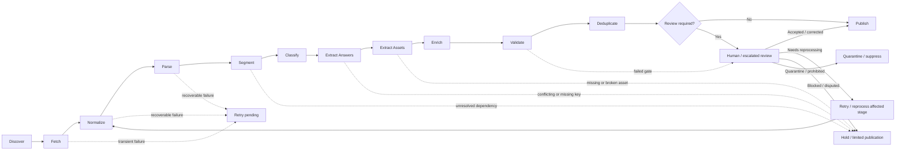

# Bestehen / Corpus — Stage 08: Ingestion and Extraction Pipeline

> **Status:** Authoritative Stage 08 product-shaping decision — in progress  
> **Product:** Bestehen / Corpus  
> **Initial domain:** German A2–B1 exam and exam-style material  
> **Primary downstream customer:** Bestehen / App  
> **Core principle:** Preserve the raw evidence and its uncertainty, progressively derive structured exam intelligence, and publish only the parts whose structure, provenance, confidence, rights, and quality gates support their intended downstream use.

## 1. Purpose and Scope

This stage defines the end-to-end **product workflow** that turns discovered or manually supplied source material into validated, traceable, structured Corpus data. It covers the lifecycle from discovery through fetch, normalization, extraction, semantic enrichment, validation, duplicate handling, selective review, and publication.

The pipeline must work for clean official HTML and PDFs, imperfect unofficial documents, scans, images, audio/video, detached answer keys, archives, incomplete exams, and mixed-media bundles. It must also preserve the earlier product decisions that:

- successful fetching or parsing does **not** imply authenticity, confidence, legal reuse permission, or correctness;
- incomplete material may remain useful without being made artificially complete;
- source expression and derived/non-reconstructive metadata have different rights implications;
- confidence, rights, taxonomy assignment confidence, extraction quality, difficulty/relevance uncertainty, and duplicate independence are separate concerns;
- structured intelligence should be produced offline/incrementally and reused by Bestehen / App rather than regenerated per learner session;
- expensive AI or human review is reserved for uncertainty that materially affects product quality.

This is product shaping, not architecture. It does not choose queues, databases, workflow engines, OCR/ASR vendors, model providers, storage technology, parser libraries, embedding models, job schedulers, or deployment topology. Later architecture may combine or parallelize the conceptual states below, but it must preserve their product semantics, gates, traceability, and failure behavior.

### 1.1 Stage objective

**Every source should have a predictable, auditable path from discovered evidence to published structured data, with partial success allowed, uncertainty preserved at the smallest useful scope, bounded retry/review behavior, and a cheap default path that escalates only when higher-cost processing is justified.**

### 1.2 What “pipeline state” means

The states below are **conceptual transformation states**, not a requirement for one physical job or database status per state. One implementation may combine several cheap deterministic operations; another may process assets in parallel. The product requirement is that Corpus can still answer:

- what has happened to this source/document/component;
- what outputs were produced;
- which outputs failed or remain unresolved;
- which method/version produced each derived field;
- which review or retry is pending;
- whether the data is eligible for a specific downstream use;
- whether a later reprocessing run superseded an earlier result.

A source can therefore be globally “partially processed” while individual Documents, Tasks, Items, Answers, Assets, transcripts, or taxonomy assignments have more precise local states.

---

## 2. Inputs / Existing Decisions

Stage 08 preserves the shared Product Overview, Identity, the live Corpus and App checklists, and Corpus Stages 01–07.

### 2.1 Stage 01 — mission and product boundary

`corpus/01-product-mission-and-boundaries.md` requires Corpus to turn broad A2/B1 material into trustworthy, rights-aware, deduplicated intelligence for Bestehen / App. Stable exam intelligence should be precomputed, batched, cached, reviewable, and reprocessable rather than generated per learner interaction.

### 2.2 Stage 02 — source strategy

`corpus/02-source-strategy.md` established automated discovery plus manual URL/file intake; HTML, PDF, DOC/DOCX, scans/images, audio, video, and ZIP/archive support; permanent provenance; source version history; bounded revisits; mirror/alternate handling; and explicit candidate → source observation → underlying material distinctions.

Stage 08 begins after or alongside discovery and must never collapse multiple observations into false independent evidence.

### 2.3 Stage 03 — confidence and trust

`corpus/03-trust-authenticity-confidence.md` requires confidence at source, document, exam, task, and item levels, with local defects overriding parent assumptions. Tier A/B/C/D and Quarantine control downstream influence. Conflicting keys are first-class disputes. Parsing success never upgrades evidence confidence automatically.

### 2.4 Stage 04 — rights and usage

`corpus/04-rights-and-usage-metadata.md` requires rights evidence to be extracted early enough to block unsafe learner-facing reuse, while still allowing reference-only material to contribute non-reconstructive intelligence. `UNKNOWN_REVIEW_REQUIRED` is the conservative default when rights are unclear. Takedown holds pause normal reprocessing and source-derived use.

### 2.5 Stage 05 — canonical exam model

`corpus/05-canonical-exam-model.md` defines Source Observation → Document → Exam/Test Set → Section → optional Part → Task → Item, with Instructions, Stimuli, Response Options, Answers, Explanations, Scoring Rules, and Assets as separately addressable supporting concepts.

Crucially, Stage 05 distinguishes:

- **source incompleteness** — the acquired source lacks expected material;
- **extraction incompleteness** — the source contains material Corpus failed or has not yet extracted;
- **linking incompleteness** — components exist but their relationship is not yet verified.

Stage 08 must preserve that distinction through every failure/review state.

### 2.6 Stage 06 — taxonomy

`corpus/06-exam-and-skill-taxonomy.md` requires deterministic structural tags first, semantic enrichment later, assignment-level origin/confidence/version, and curator-safe reprocessing. Fine-grained AI mappings remain provisional before benchmark qualification; high-impact auto-publication starts only after measured benchmark precision is strong enough for the use.

### 2.7 Stage 07 — difficulty and relevance

`corpus/07-difficulty-and-relevance-models.md` requires versioned method/origin metadata for L/R/T/A/P difficulty and GB1/TELC relevance, explicit estimate confidence, unknown/N/A handling, and offline/batched recalculation. A missing transcript, timing rule, answer, rubric, or taxonomy mapping can leave only part of a difficulty profile publishable.

No earlier decision is replaced by Stage 08.

---

## 3. Decisions and Rationale

### 3.1 Use one conceptual lifecycle with local component progress

**Decision:** Bestehen / Corpus uses the following canonical conceptual lifecycle:

**Discover → Fetch → Normalize → Parse → Segment → Classify → Extract Answers → Extract Assets → Enrich → Validate → Deduplicate → Review → Publish**

The sequence communicates responsibility and gating, not mandatory serial implementation. For example, a parser may discover an image while parsing a PDF, and asset extraction may run alongside answer extraction. The product still records the logical outputs separately so a failure in one area does not hide success in another.

### 3.2 Pipeline state diagram

`Retry / reprocess affected stage → Normalize` is shorthand: reprocessing should restart from the **earliest affected dependency**, not automatically from the beginning.

### 3.3 Publication is a promotion decision, not proof that every field is perfect

**Decision:** `Publish` means that a structured entity/field has passed the gates required for its allowed downstream use. It does **not** mean:

- the source is official;
- the rights are reusable;
- every optional field is complete;
- every item is Tier A/B;
- every task may be shown directly to learners;
- the source is unique/independent before Stage 09 logic is applied;
- every difficulty/relevance dimension is known.

Corpus can publish **limited/partial structured evidence** when the valid parts are explicitly bounded. For example, an answerless reading task may publish task shape/topic/vocabulary intelligence while remaining ineligible for correctness-dependent use.

### 3.4 Human review is exception-based, not mandatory for every source

**Decision:** Review is a conceptual gate in the lifecycle, but records that meet benchmarked auto-accept rules may pass through it without a human action. Human time is reserved for high-impact ambiguity, conflicts, unique coverage, suspicious material, and cases where a correction materially changes downstream product behavior.

---

## 4. Detailed Product Model / Rules for This Stage

## 4.1 State 1 — Discover

**Purpose:** identify a candidate source or manually supplied input worth considering.

**Inputs:** official/provider seeds, targeted discovery, bounded crawling, archive/repository lookup, manual URL, or manual file submission.

**Required outputs:**

- candidate identity/location or manual-file origin;
- discovery method/context;
- first-seen time;
- initial source/category clues;
- enough relevance evidence to justify fetch/intake.

**Success means:** the candidate is relevant enough to spend acquisition/processing effort on. It does not imply trust, rights, uniqueness, or content quality.

**Failure/exit:** irrelevant candidates are rejected from active intake but may retain minimal discovery history where useful. Inaccessible/gated candidates may remain known leads without automated circumvention.

## 4.2 State 2 — Fetch

**Purpose:** obtain the observable source payload and transport metadata through permitted access.

**Required outputs when successful:**

- retrieved bytes/content or a registered manual-file payload;
- observed content/media type and filename where applicable;
- retrieval/source metadata needed for provenance and freshness;
- redirects/resolved location where applicable;
- raw observation identity/version clues;
- clear distinction between expected content and an error/login/placeholder response.

**Success means:** Corpus obtained a recognizable payload. It does not imply that the payload is safe, authentic, complete, or parsable.

**Failure behavior:**

- transient network/server/rate-limit failures enter `retry_pending` under a bounded retry budget;
- persistent unavailable/dead observations remain in source history and follow Stage 02 revisit behavior rather than retrying indefinitely;
- authentication/paywall/access-control barriers are not bypassed; the source may wait for lawful manual intake;
- suspicious or unsafe payloads may be quarantined before normal parsing, with the detailed security policy deferred to Stage 15.

## 4.3 State 3 — Normalize

**Purpose:** convert the acquired payload into a stable processing representation without changing its evidentiary meaning.

Normalization may include conceptually:

- decomposing ZIP/archive containers into individually traceable members;
- identifying PDF pages and whether text is native or image-based;
- standardizing text encoding/line endings where harmless;
- extracting document metadata as observed claims, not verified facts;
- separating media streams/components where useful;
- producing stable page/frame/member references;
- preparing derived page images/text layers while preserving the original source artifact.

**Product rule:** normalization is non-destructive. The raw/versioned source observation remains the evidence anchor, subject to Stage 04/15 retention rules.

**Failure behavior:** a broken member need not invalidate the whole archive. Each member may proceed, fail, or remain quarantined independently while bundle provenance is retained.

## 4.4 State 4 — Parse

**Purpose:** derive machine-readable source content and coarse structure from the normalized representation.

Typical outputs include:

- native text extraction;
- OCR text/layout from scanned pages;
- document headings/numbering/order;
- tables/forms/layout relationships where recoverable;
- obvious embedded links/media references;
- candidate instruction/content blocks;
- source-provided metadata/terms/answer-key markers;
- extracted document-level structural clues.

**Product rule:** parser/OCR output is **derived evidence**, never a replacement for the raw page/file. Every parsed region needs enough lineage to identify what source/page/asset it came from.

**Failure behavior:** low-quality OCR, table flattening, unreadable regions, or malformed document sections become extraction-quality defects at the affected region/component. They do not automatically imply the source itself is incomplete.

## 4.5 State 5 — Segment

**Purpose:** map parsed material into Stage 05 canonical units and relationships.

Segmentation progressively identifies/links:

- Exam/Test Set;
- Section;
- optional Part;
- Task;
- Item/composite Item;
- Instruction;
- Stimulus/shared Stimulus;
- Response Option/shared option bank;
- candidate Scoring Rule/Rubric scopes;
- expected/missing components;
- detached/orphan components that cannot yet be linked safely.

**Product rule:** use semantic function, not page layout alone. Ambiguous boundaries remain provisional or reviewable. Do not invent fake Part/Task/Item layers simply to make the source fit a rigid shape.

**Partial success:** one intact section/task can proceed even if another section cannot be segmented. Whole-exam composition analytics remain blocked/limited when segmentation is incomplete.

## 4.6 State 6 — Classify

**Purpose:** attach normalized Stage 06 structural/context taxonomy metadata that can be established cheaply and responsibly.

The initial classification pass should prioritize:

- provider/exam-family metadata and target-style claim;
- CEFR / mixed-level handling;
- normalized Section;
- task activity family;
- response mechanic/cardinality;
- stimulus form;
- interaction shape;
- completeness/source-role metadata.

**Product rule:** deterministic/source-explicit classification is preferred where the canonical structure already provides the answer. Semantic fine tagging belongs primarily to Enrich.

**Failure/uncertainty:** uncertain provider/CEFR/section/task mapping remains `unknown`, provisional, or review-required. Classification uncertainty never converts a third-party TELC-style mock into verified TELC official material.

## 4.7 State 7 — Extract Answers

**Purpose:** identify source/reference answer assertions, candidate accepted responses, answer-key documents, model responses, and scoring relationships without pretending inferred answers are source truth.

This state produces candidate relationships such as:

- Item → keyed Response Option;
- Item → accepted option set / short answer;
- matching target → correct shared option;
- Task/Item → source-provided sample/model response;
- Answer/Task/Section → scoring rule or rubric evidence;
- detached answer-key entries awaiting exact edition/item linkage.

**Core rule:** every correctness claim remains attributable to evidence. A source answer, curator-resolved answer, and model-inferred candidate answer are different origins.

**Failure behavior:**

- missing expected answer keys remain missing;
- ambiguous numbering/version relationships remain unlinked rather than position-matched by guess;
- competing plausible keys create a local `disputed` state under Stage 03;
- answer-dependent enrichment/validation is blocked locally while non-correctness uses may continue.

## 4.8 State 8 — Extract Assets

**Purpose:** inventory and connect separately addressable media/components needed to interpret or validate the assessment.

Assets include:

- audio/video;
- images/photos/scans;
- diagrams/maps/charts;
- table/form source regions;
- visual prompt cards;
- answer-sheet templates;
- page crops retained as extraction evidence where appropriate.

For each asset, Corpus should preserve:

- provenance/source relationship;
- media role where known;
- relationship to Stimulus/Task/Item/Instruction;
- rights/confidence overrides where applicable;
- integrity/availability state;
- extraction/transcription/description/alignment state where relevant.

**Product rule:** orphan/unlinked assets are valid intermediate records. Similar filenames are evidence for a candidate relationship, not sufficient proof.

## 4.9 State 9 — Enrich

**Purpose:** derive higher-level semantic intelligence from the canonical structure and validated-enough source representation.

Enrichment can include:

- topic;
- grammar and vocabulary/domain;
- primary/secondary Reading/Listening skills;
- Writing/Speaking competency affordances;
- reasoning and distractor patterns where answer truth permits;
- lexical/paraphrase relationships;
- confidence dimensions/evidence signals;
- non-legal rights-term extraction candidates;
- Stage 07 L/R/T/A/P difficulty features/estimates;
- GB1/TELC relevance features/estimates;
- candidate relationships and review signals.

**Product rule:** enrichment is evidence-producing, not truth-producing. Every derived field carries origin/method/version/confidence and may remain provisional.

## 4.10 State 10 — Validate

**Purpose:** decide whether the derived structure and metadata are internally coherent enough for their proposed uses before publication.

Stage 08 validation is the **pipeline gate**, not the full Stage 10 QA specification. It must at minimum detect/route:

- impossible/missing structural relationships;
- duplicate numbering or cardinality contradictions;
- answer links that do not reference valid options/items;
- expected answer/audio/image dependencies that are missing;
- unresolved extraction-quality defects affecting a high-impact field;
- contradictory provider/level/section claims;
- source completeness versus extraction completeness mismatches;
- rights/trust/review states that block the proposed use;
- enrichment outputs produced from inputs too weak for the claimed precision.

A record may pass validation **for one use and not another**. For example, a task can be valid for topic frequency but invalid for answer-grounded distractor analysis.

Stage 10 later defines production QA metrics, benchmark checks, sampling, and final production-ready quality criteria.

## 4.11 State 11 — Deduplicate

**Purpose:** determine enough duplicate/independence status that publication cannot accidentally treat mirrors/reformats as independent evidence.

Stage 08 locks the pipeline requirement, while **Stage 09 owns the algorithms, thresholds, canonical-record selection, derivative semantics, and frequency rules**.

Before decision-grade publication/analytics, a record must be either:

- linked to an established duplicate/derivative/independence cluster;
- conservatively marked as independence unresolved so it cannot inflate recurrence/corroboration;
- or explicitly treated as a unique candidate only where the evidence is sufficient.

**Product rule:** deduplication uncertainty reduces evidence mass; it never defaults to “independent.”

## 4.12 State 12 — Review

**Purpose:** resolve or deliberately preserve material uncertainty that should not be auto-accepted.

Review can happen earlier as an exception, but this state is the final conceptual gate before publication. Review may produce:

- accepted;
- accepted with restrictions;
- corrected then accepted;
- keep provisional/limited;
- disputed;
- retry/reprocess requested;
- awaiting dependency/corroboration;
- quarantined;
- rejected as evidence;
- rights/legal review required;
- takedown hold/prohibited.

Detailed checkpoints and auto-accept rules are completed later in this document.

## 4.13 State 13 — Publish

**Purpose:** promote validated structured outputs into the current active Corpus view with their use restrictions intact.

A publishable output must retain:

- source/document/entity lineage;
- current trust/authenticity state;
- rights/usage state;
- extraction/assignment/estimate confidence where relevant;
- method/model/rule/taxonomy version for derived metadata;
- review state/overrides;
- completeness and unresolved dependencies;
- duplicate/independence treatment;
- current-versus-superseded status.

### Publication classes

The product supports three practical outcomes:

1. **Published — normal eligible use:** the entity/field passes the gates for its documented downstream uses.
2. **Published — limited/provisional:** structurally useful evidence is available only for explicitly bounded uses, such as exploratory analytics, broad context tags, or non-correctness analysis.
3. **Not active / held:** the material remains in retry, review, disputed, quarantine, prohibited, or unresolved-dependency state and is excluded from uses it cannot support.

Publication is therefore field/entity/use-aware, not one document-level boolean.

---

## 4.14 Partial-failure model

**Decision:** Bestehen / Corpus follows **salvage-first, isolate-the-failure** behavior. A failure blocks only the smallest scope whose correctness depends on it unless the defect shows the larger unit is unreliable.

### Required partial-failure distinctions

| Failure type | Meaning | Default product behavior |
|---|---|---|
| **Fetch failure** | Source payload not obtained | bounded retry or later source revisit; no downstream extraction from this observation |
| **Normalization/container failure** | One archive member/page/media component cannot be prepared | isolate member/component; continue with unaffected members if safe |
| **Extraction failure** | Source contains content but parse/OCR/ASR did not recover it reliably | mark extraction incomplete; retry with alternative method or review; never mark source content as absent merely because extraction failed |
| **Segmentation failure** | Parsed content exists but canonical boundary/relationship is uncertain | keep broader parent structure and/or unresolved component; block fine-grained analytics only |
| **Linking failure** | Components exist but relationship is uncertain | preserve detached assets/keys/transcripts; do not force-link by filename/position alone |
| **Classification/enrichment failure** | semantic metadata cannot be assigned responsibly | keep field unknown/provisional; publish stronger structural data if eligible |
| **Validation failure** | derived output contradicts integrity/use rules | block affected output; route to review/reprocessing |
| **Deduplication uncertainty** | independence cannot be established | count conservatively / exclude from recurrence until resolved |
| **Rights/trust hold** | evidence may be structurally correct but product use is restricted | preserve eligible non-reconstructive intelligence; block prohibited/direct uses |
| **Quarantine** | serious integrity, fake/tamper, unsafe, or prohibition concern | zero normal downstream influence until explicitly resolved |

### Salvage examples

- A 60-page PDF with two unreadable pages may still publish the intact Tasks while Exam completeness is limited.
- A listening task with missing audio may publish its instruction/task structure but cannot produce audio difficulty or listening-content intelligence.
- An audio file with unreliable ASR may still contribute acoustic features while semantic transcript-based enrichment remains low-confidence/unknown.
- A disputed answer blocks correctness and distractor analysis for the affected Item, not topic/vocabulary analysis of an otherwise sound passage.
- A restricted image can block direct reuse of the composite Task while non-reconstructive structural tags remain publishable.

## 4.15 Retry, hold, and terminal/intervention states

Pipeline processing must support the following conceptual side states:

- **`retry_pending`** — a recoverable/transient failure should be retried under a bounded budget;
- **`reprocess_candidate`** — a better method/version exists or an upstream dependency changed;
- **`blocked_dependency`** — required companion evidence is missing or unresolved, such as detached key/audio/edition link;
- **`review_required`** — human or escalated model review is worthwhile because product impact justifies it;
- **`disputed`** — strong evidence conflicts on a material claim and the affected use is blocked;
- **`quarantined`** — zero normal influence pending resolution;
- **`rejected_as_evidence`** — no normal analytical/product influence, with minimal provenance retained according to policy;
- **`prohibited/takedown_hold`** — rights/security state blocks normal processing/use under Stage 04/15;
- **`superseded`** — a later successful processing result replaces this derived version in the current active view without deleting history.

### Retry principles

1. **No infinite retries.** Repeated unchanged-input/unchanged-method failure eventually leaves automatic retry and becomes deferred/reviewable.
2. **Retry only the affected dependency.** A failed ASR pass should not refetch and reparse a stable PDF booklet.
3. **Differentiate transient from deterministic failure.** Network/server failure is retryable; a consistently unsupported document pattern normally needs another method/parser or human review rather than repeated identical attempts.
4. **Do not spend premium processing to rescue low-value noise automatically.** A unique TELC asset or benchmark item can justify escalation; a redundant low-confidence duplicate usually cannot.
5. **Preserve failure reason and method version** so a later improved method can target the right records.

Exact numerical retry limits and scheduling are intentionally deferred to Stage 14/architecture; Stage 08 requires bounded, impact-aware behavior rather than a specific queue implementation.

---

## 5. Edge Cases / Failure or Uncertainty Handling — Initial State Model

### 5.1 One source page links a booklet, key, and audio but audio fetch fails

Publish/process the booklet and key normally. Keep the audio Asset relationship as expected/missing or failed-fetch. Listening tasks remain incomplete for audio-dependent use until the asset is recovered.

### 5.2 ZIP contains one corrupt file

Keep the archive provenance and process the healthy members. The corrupt member receives a local failure state. Do not reject the entire bundle automatically.

### 5.3 PDF parser returns no text for a scan

Treat it as an extraction-path decision: route to scan/OCR handling rather than concluding the document is empty.

### 5.4 OCR recovers question numbers but not answer choices reliably

The Task/Item skeleton may be useful, but choices/answers remain extraction-incomplete. No answer-dependent enrichment or learner-facing source use should proceed from guessed option text.

### 5.5 Answer key is parsed successfully but exact exam edition is uncertain

Keep it as a detached/candidate key relationship. Do not auto-link by numbering alone when version mismatch could create wrong answers.

### 5.6 Classification fails on one Item

Retain the item with broader Task/Section metadata and unknown/provisional fine tags. Do not block the rest of the exam.

### 5.7 Deduplication has not yet established whether two mocks are independent

Both provenance observations may be searchable, but published recurrence/corroboration treats them conservatively until Stage 09 resolves the relationship.

### 5.8 Review backlog grows

Low-impact provisional records remain limited rather than forcing blanket review. Human attention is reserved for material whose resolution changes correctness, TELC target assumptions, benchmark quality, high-value coverage, or direct learner use.

---

## 6. Relationship to Other Bestehen Stages — Initial Handoffs

- **Stage 09 — Duplicate and Near-Duplicate Detection:** owns fingerprinting, similarity thresholds, derivative rules, canonical-record selection, and independent-evidence counting. Stage 08 only requires a deduplication gate and conservative unresolved behavior.
- **Stage 10 — Validation and QA:** owns benchmarked extraction accuracy, manual QA sampling, production-ready definitions, regression tests, and final quality metrics. Stage 08 defines the lifecycle gate and failure routing that Stage 10 will measure.
- **Stage 12 — Corpus → App Contract:** will decide which published classes/fields are exposed to App and how reclassification/removal propagates.
- **Stage 13 — Corpus Operations:** will turn retry/review/quarantine/reprocessing states into maintainable operator workflows.
- **Stage 14 — Cost, Scale, and Automation:** will set concrete retry counts, volumes, budgets, model tiers, and cost targets.
- **Stage 15 — Security and Abuse:** will define sandboxing, URL/file sanitization, malicious-content handling, and raw retention.
- **Stage 16 — Benchmark Corpus:** will calibrate extraction/auto-accept thresholds and prove the pipeline against representative clean and imperfect sources.

---

## 7. Cost Notes — Initial Pipeline Defaults

The pipeline creates meaningful cost risk because every discovered source can multiply into OCR, transcription, semantic tagging, validation, and review work. The Stage 08 default is therefore **cheap breadth first, expensive precision only where value warrants it**.

Initial low-cost rules:

- reject irrelevant candidates before expensive extraction;
- avoid refetching/reprocessing unchanged evidence;
- prefer native text and deterministic parsing before OCR/AI;
- parse/segment shared content once rather than per Item;
- isolate failed components rather than restarting whole documents;
- allow unknown/provisional fields instead of paying to resolve every ambiguity;
- keep low-value failures deferred rather than repeatedly retrying them;
- batch semantic enrichment offline;
- reserve manual/premium escalation for high-impact or unique evidence.

Detailed processing tiers, media-specific escalation, and AI traceability are completed in the next committed revision of this Stage 08 artifact.
